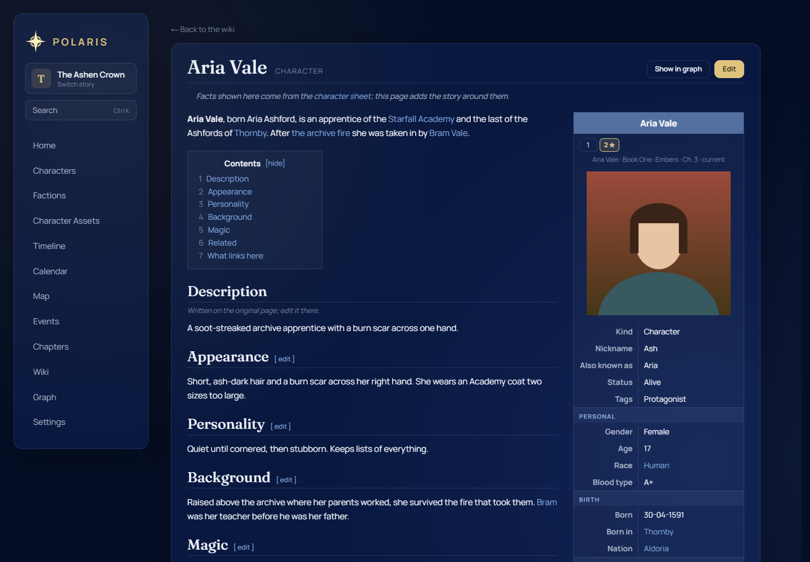
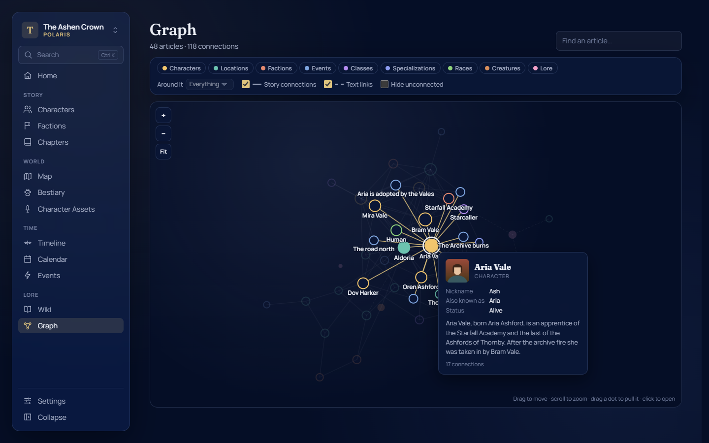
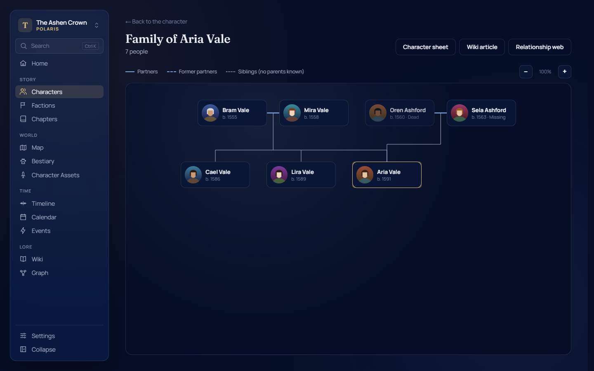
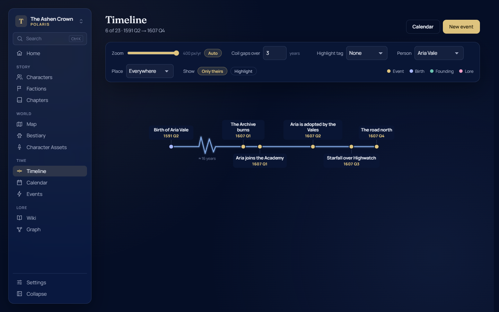
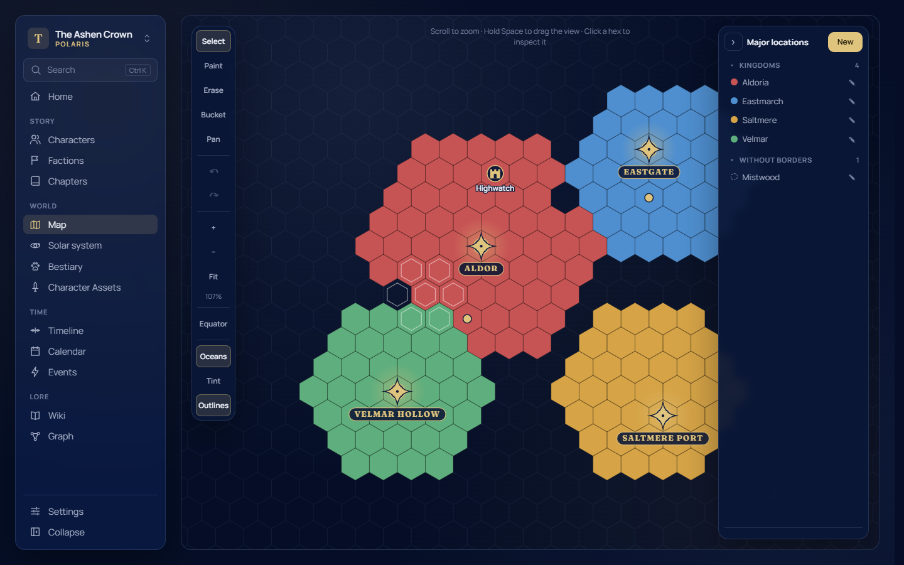
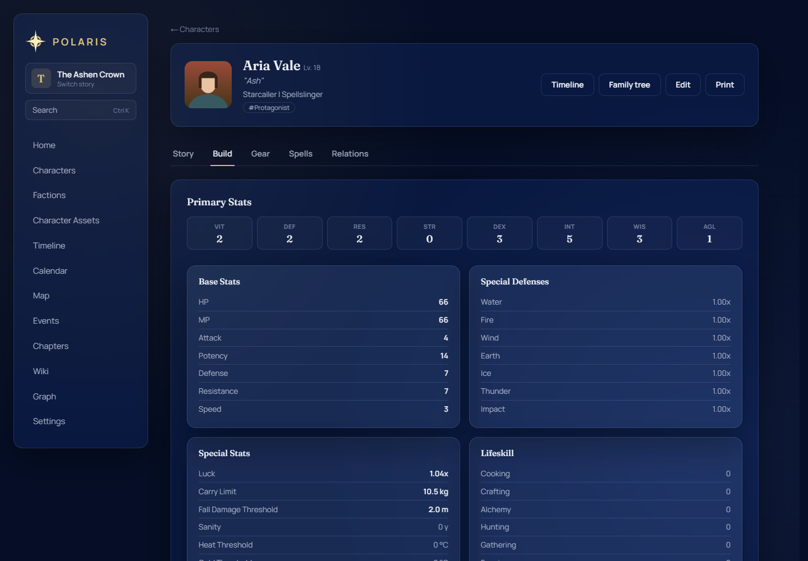

# Polaris

Polaris is a self-hosted organizer for writing stories. It keeps everything
about a story in one place that you own: characters and how they change over
the chapters, who they are to each other, the map, the calendar and history
of the world, and a wiki that writes itself from all of it. It grew out of
writing LitRPG, so characters also have levels, stats, gear and spells.

Polaris is a single Go program with the web interface built in. Each story
has its own SQLite database, so it runs comfortably on a small home server.

> **Provided as is.** Polaris was built for personal use and is shared in case
> it is useful to others. There is no support and no commitment to future
> updates. See [LICENSE](LICENSE) (MIT).

## Features

- **Characters** change over the story in versions (renames, new classes,
  a new status), which you can compare side by side. Each has tags, computed
  stats, a gear paper-doll, a spell list and a printable sheet.
- **Relations and families**: parents, partners, mentors and rivals, each
  holding from one chapter or date to another, so every version shows the
  relations of its own time. Family trees are drawn from them. Factions have
  ranks and can nest, and every kingdom on the map is a faction too.
- **World**: a paintable hex map of kingdoms, regions, cities and capitals,
  a bestiary of the monsters, animals and constructs that live there, and
  Character Assets (classes, races, gear, spells…) that grant stat bonuses.
- **Time**: your own calendar (months and days), events tied to places,
  people and chapters, a timeline drawn to scale, a month-by-month calendar
  view, and chapters grouped into volumes.
- **Wiki**: every character, place, faction, event and asset already has an
  article, built live from the story. You add the lore in Markdown with a
  formatting toolbar, link articles with `[[…]]` (a picker finds them for
  you) and see a preview when hovering a link. Free-form articles cover
  gods, history or magic; galleries hold pictures; a character's article
  has a tab per version; and a graph shows how everything connects.
- **Everyday**: Ctrl+K search, any number of separate stories with `.zip`
  export and import, English, Português (BR) and Español (ES and Latin
  America), five colour themes, and a layout that works on phones.

## Screenshots

Made with a demo story of invented data.

| | |
|---|---|
|  **Wiki**: an article built from the story, with your text, version tabs and a grouped infobox. |  **Graph**: every article and connection; hovering a dot lights up its neighbours. |
|  **Family tree**: born to one couple, adopted by another. |  **Timeline**: one character's life, long gaps coiled up. |
|  **Map**: kingdoms, regions, cities and capitals. |  **Character sheet**: stats computed from class, race and gear. |

## Security

> [!WARNING]
> **Polaris has no login.** Anyone who can reach it can read and change
> everything.

For this reason the default setup listens only on `127.0.0.1`, so only the
machine running it can open it.

To use Polaris from other devices, put your own access control in front of
it, for example:

- a reverse proxy that requires authentication,
- a VPN such as Tailscale or WireGuard, or
- a tunnel with access control, such as Cloudflare Tunnel with Cloudflare
  Access.

Then set `BIND_ADDR` (see [Configuration](#configuration)) so it listens on
your network. **Do not forward its port directly to the internet.**

## Quick start (Docker)

Requirements: Docker with the Compose plugin.

```bash
git clone https://github.com/AstraLumi/polaris.git
cd polaris
docker compose up -d
```

This runs the ready-made image of the latest release
(`ghcr.io/astralumi/polaris`, for amd64 and arm64). To build it from the code
in the folder instead, use `docker compose up -d --build`.

Open <http://localhost:8091> and create your first story.

## Configuration

Copy `.env.example` to `.env` and edit it. Docker Compose reads it
automatically, and git ignores it, so your settings are kept across updates.

| Variable    | Default     | Description                                                       |
|-------------|-------------|-------------------------------------------------------------------|
| `BIND_ADDR` | `127.0.0.1` | Host address to listen on. `0.0.0.0` exposes it to your network.  |
| `HOST_PORT` | `8091`      | Port on the host.                                                 |
| `POLARIS_VERSION` | `latest` | Release to run, such as `2.0.0`, to stay on it until you change it. |

The application itself reads the following variables. `docker-compose.yml`
already sets them, so you only need them when
[running without Docker](#running-without-docker).

| Variable      | Default        | Description                                |
|---------------|----------------|--------------------------------------------|
| `PORT`        | `8091`         | Port the server listens on.                |
| `DATA_DIR`    | `/data`        | Folder for the story databases.            |
| `UPLOADS_DIR` | `/app/uploads` | Folder for uploaded pictures and icons.    |

## Data and backups

All data is stored in two Docker named volumes, which rebuilding or updating
the container never touches:

- `polaris_data`: the story databases
- `polaris_uploads`: uploaded pictures and icons

**Export (recommended).** On the story picker, **Export** saves a story,
including its database and pictures, as a `.zip`. **Import** restores a zip as
a new story, which also lets you move stories to another machine. Export
regularly, and always before updating.

**Raw volume backup.** To archive the volumes directly:

```bash
docker run --rm -v polaris_data:/d -v "$PWD":/b alpine tar czf /b/polaris_data.tgz -C /d .
docker run --rm -v polaris_uploads:/d -v "$PWD":/b alpine tar czf /b/polaris_uploads.tgz -C /d .
```

## Updating

What changed in each version is in [CHANGELOG.md](CHANGELOG.md) and on the
[Releases](https://github.com/AstraLumi/polaris/releases) page; an update that
upgrades the databases says so at the top. Back up first (see above), then run:

```bash
./scripts/update.sh
```

The script pulls the latest code (fast-forward only) and image, restarts the
container, and removes old images. Doing it by hand is equivalent to:

```bash
git pull
docker compose pull
docker compose up -d
```

If you build from source, run `./scripts/update.sh --build` instead.

Databases are upgraded automatically on start-up and keep all their data.
Upgrades are one-way: once upgraded, a database cannot be opened by an older
version of Polaris.

## Running without Docker

Requirements: Go 1.26+ and Node.js 24+.

```bash
cd frontend && npm ci && npm run build
cp -r dist/. ../backend/static/
cd ../backend
go build -o polaris .
DATA_DIR=./data UPLOADS_DIR=./data/uploads ./polaris
```

The server listens on port 8091 on **all interfaces**. If the machine is on a
shared network, restrict access as described under [Security](#security).

## Stats

Which stats characters have, and how each one is calculated, is up to each
story: open **Settings → Stats**. A new story starts with the stats Polaris
has always had (VIT, STR, HP, Attack, Luck, Carry Limit and the rest), so
nothing changes until you change it.

Stats come in five fixed categories, each with its own behaviour:

| Category | How it works |
|---|---|
| **Primary Stats** | Points are spent on them; a character has as many points as the *points to spend* formula gives (by default one per level). Their value is the points plus bonuses. |
| **Base Stats** | Calculated by formula. Bonuses from classes, subclasses, specializations, races and body types count once per level; gear bonuses count once. |
| **Special Stats**, **Special Defenses**, **Lifeskills** | Calculated by formula. Every bonus counts once. |

In each category you can add, remove, rename and reorder stats and change
their formulas. A formula is built from blocks: values (the character's
level, age, height, weight, any stat, or a **Typed value** that gives the stat
a box on the character sheet), numbers, `+ − × ÷ ^` and brackets, and a few
functions (`min`, `max`, `round`, `clamp`, `curve`, …). For example:

> HP = 10 + **VIT** × 10 + **Level** × 2

Bonuses from classes, races and gear are added on their own, as the table
above says. To decide yourself how one counts, use its block (**Class bonus**,
**Race bonus**, **Gear bonus**, …): it holds the bonus as typed on the asset,
and a formula that uses it takes that bonus over, for example
HP = 10 + **VIT** × 10 + **Race bonus** × **Level** × 2.

Each stat can also have a unit, a number of decimals, a lowest and highest
value, and a multiplier (Carry Limit uses one: the stronger the character,
the more they carry). A stat can be marked **Lower is better** (Cold Threshold
is: a lower threshold stands more cold), so negative bonuses and falling
values show as improvements. A preview shows what every formula gives for a
sample character while you edit.

Stats are calculated every time a character is shown and never stored, so
saving updates every character at once. Removing a stat also removes what was
typed for it on character sheets and the bonuses given to it (Polaris asks
first). Copying another story's Character Assets copies its stats too.

## Privacy

The interface loads its fonts from Google Fonts, so your browser contacts
Google to fetch them. Polaris makes no other external requests.

## Development

Architecture notes and contribution guidelines are in
[docs/DEVELOPMENT.md](docs/DEVELOPMENT.md).
