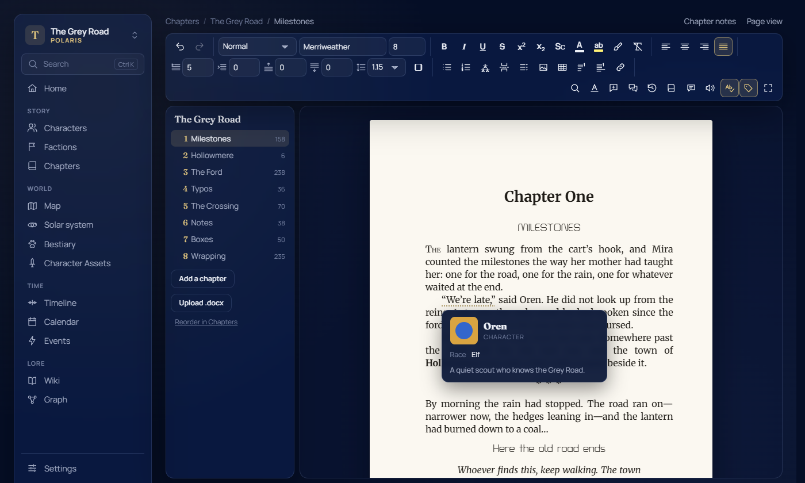
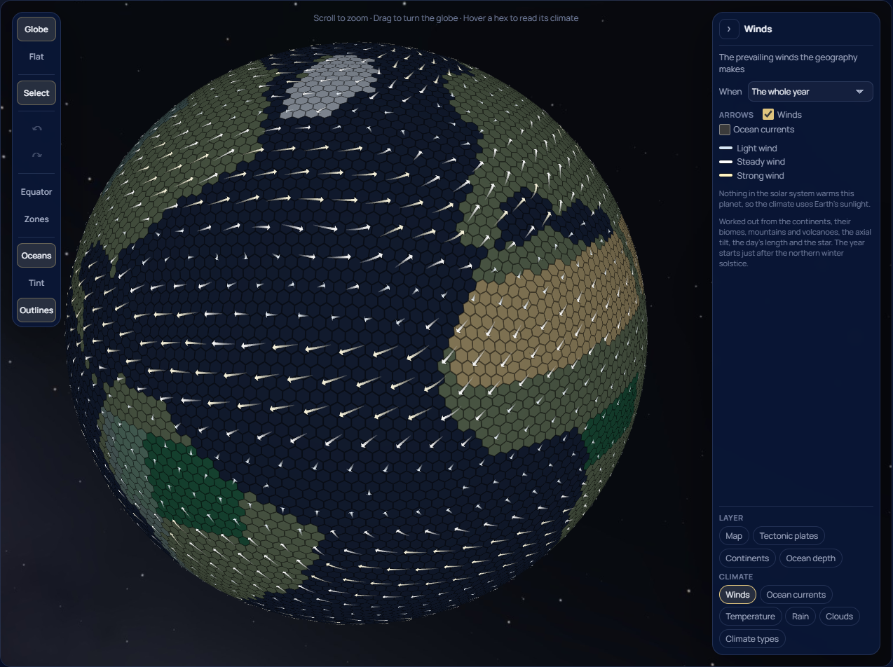
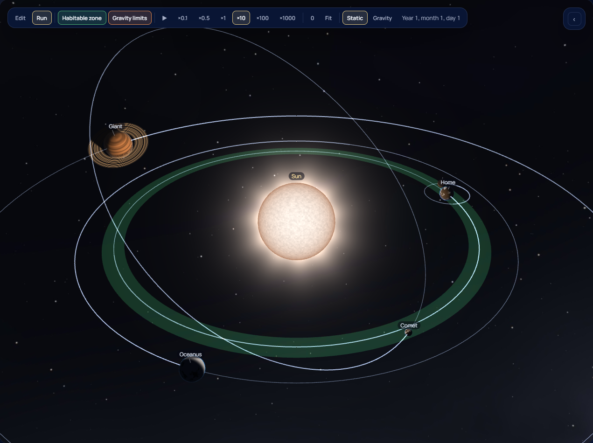
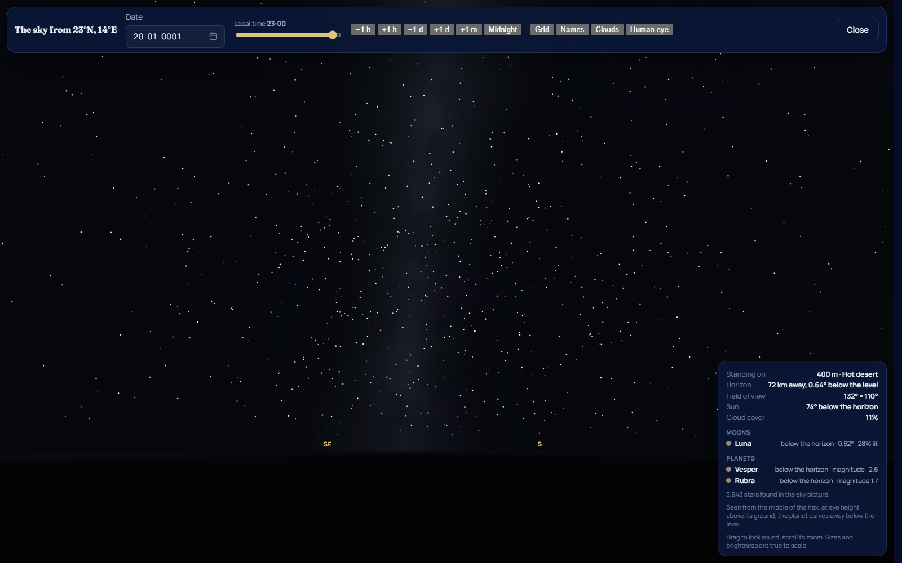
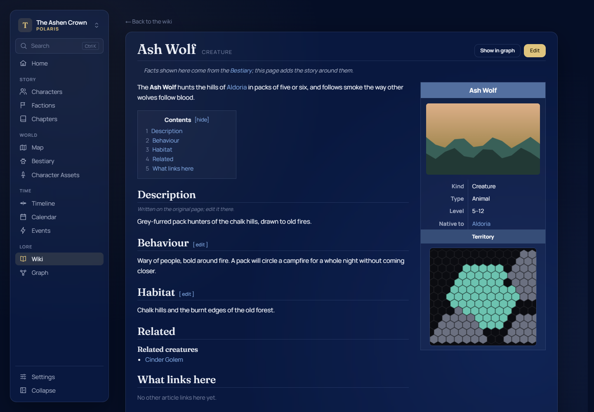
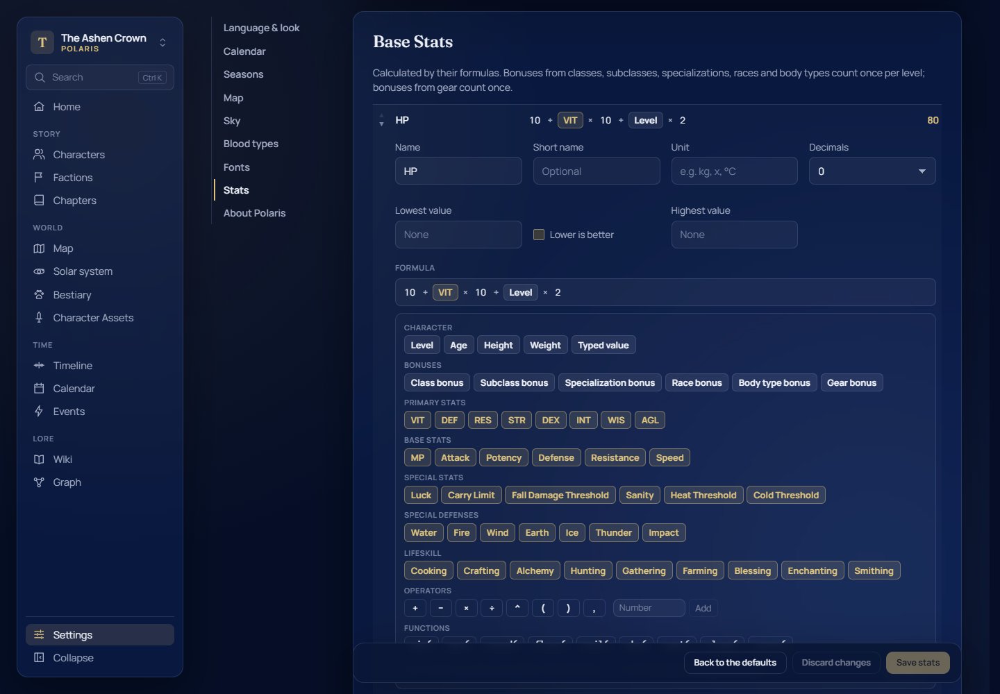

<p align="center">
  
</p>

<h1 align="center">Polaris</h1>

<p align="center">
  <b>Write the book and build the world it happens in, in one app you host yourself.</b><br />
  Characters, maps, planets, calendars, a wiki that writes itself, and a manuscript editor that speaks Word.
</p>

<p align="center">
  <a href="https://github.com/AstraLumi/polaris/releases/latest"></a>
  <a href="LICENSE"></a>
  <a href="#quick-start-docker"></a>
</p>

<p align="center">
  
  
</p>

Polaris keeps everything about a story in one place that you own: the
characters and how they change from chapter to chapter, who they are to each
other, the map and the planet it sits on, the calendar and history of the
world, and the manuscript itself. Everything links to everything, so the wiki
fills itself in as you go.

It grew out of writing LitRPG, so characters can also have levels, stats,
classes, gear and spells, with formulas you define. If your story has none of
that, leave those pages empty.

Polaris is one Go program with the web interface built in, and every story is
its own SQLite file. It runs happily on a Raspberry Pi or a small home server,
and on your phone it installs like an app.

> **Provided as is.** Polaris was built for personal use and is shared in case
> it is useful to others. There is no support and no commitment to future
> updates. It is licensed under the AGPL-3.0 with a few additional terms; see
> [License](#license).

## What it does

### ✍️ Write the book

- **A manuscript editor that works like Word**: styles, fonts, find and
  replace, comments, footnotes and endnotes, tables, pictures with text
  wrapping, drop caps, a Format Painter, a symbol browser, and system-window
  boxes for the LitRPG crowd.
- **Real pages while you write.** Pick A4, A5, A6, a custom trim size or an
  online post. Pages break where Word would break them, and a page view adds
  headers, footers, page numbers and a table of contents, ready to print to
  PDF.
- **Word in, Word out.** Upload a `.docx` and it becomes chapters, keeping its
  formatting, pictures, comments and page setup. Export `.docx`, EPUB, HTML,
  Markdown or plain text.
- **It knows your story.** The spellchecker accepts your characters' names.
  Tag a line of dialogue with who says it, and each character gets a list of
  their lines. Each wiki article lists the chapters that mention it.
- **Never lose a word.** It saves as you type, keeps versions every 30
  minutes, warns about edits from another tab, and works offline: changes
  upload when you're back online.
- **Fonts you can publish with.** 26 open-licensed fonts come built in,
  including book serifs, sci-fi "system window" faces, handwriting and
  Japanese. You can upload your own. Each book lists its fonts with their
  licenses and flags any you can't legally embed in an e-book.

### 🌍 Build the world

<p align="center">
  
  
</p>

- **A map that becomes a planet.** Paint kingdoms, regions, oceans and cities
  on a flat hex map, or on a whole 3D globe of hexes with flat projections
  (Mercator, Robinson, Mollweide…).
- **A climate worked out from your geography.** Paint continents, biomes,
  mountains and ocean depths, and Polaris derives the winds, ocean currents,
  temperature, rain, clouds and climate zones for any month. Mountains steer
  the winds and dry the air behind them.
- **A solar system with real physics.** Real star classes, from brown dwarfs
  and red giants to neutron stars and black holes. Planets and moons follow elliptical, tilted orbits, or live
  n-body gravity if you dare. There are rings, eclipses, habitable zones, and
  even Dyson spheres.
- **The true sky from any hex, on any date and hour**: the sun, the moons
  with their phases, the planets, and the stars, all to scale.
- **A bestiary** of your creatures, with territories drawn on the map, and
  **Character Assets** (classes, races, gear, spells) that feed the stats.

### 🧑‍🤝‍🧑 Keep track of characters

- **Characters change over the story.** Each change (a rename, a new class,
  a death) is a version tied to a chapter. Compare versions side by side.
- **Relations that hold for a time**: parents, partners, mentors and rivals,
  from one chapter or date to another. Family trees draw themselves, and
  factions have ranks and nest.
- **Stats your way.** Each story defines its own stats and formulas, built
  from blocks (see [Stats](#stats)), shown on a printable character sheet
  with a gear paper-doll and a spell list.
- **A height chart** lines the cast up to scale.

### 📚 A wiki that writes itself

- **Every character, place, faction, event, creature and planet already has
  an article**, built live from the story. You add the lore in Markdown.
- **Links survive renames.** Link with `[[…]]` and a picker finds the page;
  links are stored by id, so renaming a character fixes every mention.
  Hovering a link shows a preview.
- **See it all**: a graph of how everything connects, a timeline drawn to
  scale, and a calendar with your own months, eras and seasons.

### 🏠 Yours

- Self-hosted, with no account and no telemetry. Each story exports to a `.zip`.
- Any number of separate stories, Ctrl+K search everywhere, five colour
  themes, a layout that works on phones.
- In English, Português (BR) and Español (ES and Latin America).

## Screenshots

Made with demo stories of invented data.

| | |
|---|---|
|  **Wiki**: an article built from the story, with your text, version tabs and a grouped infobox. |  **Graph**: every article and connection; hovering a dot lights up its neighbours. |
|  **Planet**: the prevailing winds, worked out from the continents and mountains. |  **Solar system**: orbits, a habitable zone and a ringed giant, in 3D. |
|  **Family tree**: born to one couple, adopted by another. |  **Timeline**: one character's life, long gaps coiled up. |
|  **Map**: kingdoms, regions, cities and capitals. |  **Character sheet**: stats computed from class, race and gear. |
|  **Bestiary**: a creature's article, with its territory drawn on the map's hexes. |  **Stats**: every stat's formula, built from blocks. |
|  **Writing**: an A6 page, a tagged line of dialogue and its speaker's card. |  **Sky**: midnight from a desert hex, stars found in the sky picture. |

## Security

> [!WARNING]
> **Polaris has no login.** Anyone who can reach it can read and change
> everything.

For this reason the default setup listens only on `127.0.0.1`, so only the
machine running it can open it.

To use Polaris from other devices, put your own access control in front of
it, for example:

- a reverse proxy that requires authentication,
- a VPN such as Tailscale or WireGuard, or
- a tunnel with access control, such as Cloudflare Tunnel with Cloudflare
  Access.

Then set `BIND_ADDR` (see [Configuration](#configuration)) so it listens on
your network. **Do not forward its port directly to the internet.**

## Quick start (Docker)

Requirements: Docker with the Compose plugin.

```bash
git clone https://github.com/AstraLumi/polaris.git
cd polaris
docker compose up -d
```

This runs the ready-made image of the latest release
(`ghcr.io/astralumi/polaris`, for amd64 and arm64). To build it from the code
in the folder instead, use `docker compose up -d --build`.

Open <http://localhost:8091> and create your first story.

## Configuration

Copy `.env.example` to `.env` and edit it. Docker Compose reads it
automatically, and git ignores it, so your settings are kept across updates.

| Variable    | Default     | Description                                                       |
|-------------|-------------|-------------------------------------------------------------------|
| `BIND_ADDR` | `127.0.0.1` | Host address to listen on. `0.0.0.0` exposes it to your network.  |
| `HOST_PORT` | `8091`      | Port on the host.                                                 |
| `POLARIS_VERSION` | `latest` | Release to run, such as `3.0.0`, to stay on it until you change it. |

The application itself reads the following variables. `docker-compose.yml`
already sets them, so you only need them when
[running without Docker](#running-without-docker).

| Variable      | Default        | Description                                |
|---------------|----------------|--------------------------------------------|
| `PORT`        | `8091`         | Port the server listens on.                |
| `LISTEN_HOST` | (all)          | Address to listen on, e.g. `127.0.0.1` to accept connections from this machine only. |
| `DATA_DIR`    | `/data`        | Folder for the story databases.            |
| `UPLOADS_DIR` | `/app/uploads` | Folder for uploaded pictures and icons.    |

## Data and backups

All data is stored in two Docker named volumes, which rebuilding or updating
the container never touches:

- `polaris_data`: the story databases
- `polaris_uploads`: uploaded pictures and icons

**Export (recommended).** On the story picker, **Export** saves a story,
including its database and pictures, as a `.zip`. **Import** restores a zip as
a new story, which also lets you move stories to another machine. Export
regularly, and always before updating.

**Raw volume backup.** To archive the volumes directly:

```bash
docker run --rm -v polaris_data:/d -v "$PWD":/b alpine tar czf /b/polaris_data.tgz -C /d .
docker run --rm -v polaris_uploads:/d -v "$PWD":/b alpine tar czf /b/polaris_uploads.tgz -C /d .
```

## Updating

What changed in each version is in [CHANGELOG.md](CHANGELOG.md) and on the
[Releases](https://github.com/AstraLumi/polaris/releases) page; an update that
upgrades the databases says so at the top. Back up first (see above), then run:

```bash
./scripts/update.sh
```

The script pulls the latest code (fast-forward only) and image, restarts the
container, and removes old images. Doing it by hand is equivalent to:

```bash
git pull
docker compose pull
docker compose up -d
```

If you build from source, run `./scripts/update.sh --build` instead.

Databases are upgraded automatically on start-up and keep all their data.
Upgrades are one-way: once upgraded, a database cannot be opened by an older
version of Polaris.

## Running without Docker

Requirements: Go 1.26+ and Node.js 24+.

```bash
cd frontend && npm ci && npm run build
cp -r dist/. ../backend/static/
cd ../backend
go build -o polaris .
DATA_DIR=./data UPLOADS_DIR=./data/uploads ./polaris
```

The server listens on port 8091 on **all interfaces**. If the machine is on a
shared network, restrict access as described under [Security](#security).

## Stats

Which stats characters have, and how each one is calculated, is up to each
story: open **Settings → Stats**. A new story starts with the stats Polaris
has always had (VIT, STR, HP, Attack, Luck, Carry Limit and the rest), so
nothing changes until you change it.

Stats come in five fixed categories, each with its own behaviour:

| Category | How it works |
|---|---|
| **Primary Stats** | Points are spent on them; a character has as many points as the *points to spend* formula gives (by default one per level). Their value is the points plus bonuses. |
| **Base Stats** | Calculated by formula. Bonuses from classes, subclasses, specializations, races and body types count once per level; gear bonuses count once. |
| **Special Stats**, **Special Defenses**, **Lifeskills** | Calculated by formula. Every bonus counts once. |

In each category you can add, remove, rename and reorder stats and change
their formulas. A formula is built from blocks: values (the character's
level, age, height, weight, any stat, or a **Typed value** that gives the stat
a box on the character sheet), numbers, `+ − × ÷ ^` and brackets, and a few
functions (`min`, `max`, `round`, `clamp`, `curve`, …). For example:

> HP = 10 + **VIT** × 10 + **Level** × 2

Bonuses from classes, races and gear are added on their own, as the table
above says. To decide yourself how one counts, use its block (**Class bonus**,
**Race bonus**, **Gear bonus**, …): it holds the bonus as typed on the asset,
and a formula that uses it takes that bonus over, for example
HP = 10 + **VIT** × 10 + **Race bonus** × **Level** × 2.

Each stat can also have a unit, a number of decimals, a lowest and highest
value, and a multiplier (Carry Limit uses one: the stronger the character,
the more they carry). A stat can be marked **Lower is better** (Cold Threshold
is: a lower threshold stands more cold), so negative bonuses and falling
values show as improvements. A preview shows what every formula gives for a
sample character while you edit.

Stats are calculated every time a character is shown and never stored, so
saving updates every character at once. Removing a stat also removes what was
typed for it on character sheets and the bonuses given to it (Polaris asks
first). Copying another story's Character Assets copies its stats too.

## Privacy

Polaris sends nothing about you or your stories anywhere. It reaches out in
only these cases:

- The interface's own fonts load from Google Fonts, so your browser contacts
  Google for them.
- In the writing editor, a book font that is neither built in nor in your
  fonts library is fetched from Google Fonts. The server also asks Google
  Fonts for that font's line spacing and license, and keeps the answers.

The 26 built-in book fonts and the spelling dictionaries are served by Polaris
itself.

## Development

Architecture notes and contribution guidelines are in
[docs/DEVELOPMENT.md](docs/DEVELOPMENT.md).

## License

Polaris is free software under the [GNU Affero General Public License,
version 3](LICENSE) (AGPL-3.0-only), with the additional terms in
[NOTICE.md](NOTICE.md). In plain words:

- You can use it, change it and share it, for free, for any purpose.
- If you share a changed version, or run one that other people use over the
  network (a hosted service, say), you must offer them its full source code
  under the same license. Whatever you add goes back to everyone.
- Keep the credit: "Based on Polaris by AstraLumi", linking to this
  repository, in your README and in the app's About page.
- A changed version goes under its own name and logo, and says that it is
  changed. It may say it is based on Polaris.
- It comes without any warranty.

The license text decides; this summary doesn't replace it.
